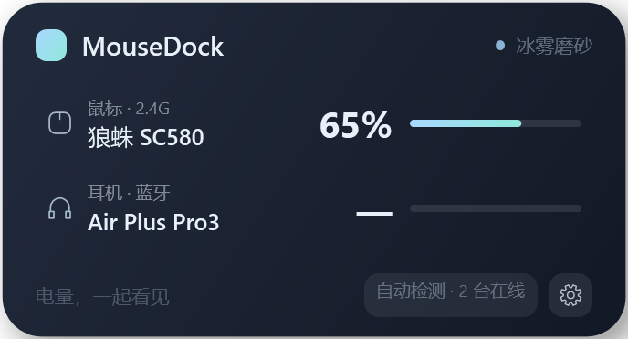

# MouseDock

> Windows 桌面外设电量面板 —— 2.4G / 蓝牙 / 有线自动识别，电量实时刷新。
> 不联网、不上传、无遥测；读不到电量就显示 `—`，绝不编数字。



## 特性

- **只显示当前连接的设备**：内置键盘 / 触摸板 / 摄像头自动过滤；拔出即从列表消失
- **按物理设备去重**：接收器与它背后的鼠标合并成一台，不会出现「接收器 + 鼠标」两条
- **通道判定**：`2.4G` / `蓝牙` / `蓝牙 LE` / `有线`，依据设备路径与产品串，不靠猜
- **电量多策略**：HID 标准电池 → Logitech HID++ → 厂商 32 字节私有协议 → BLE GATT
- **实时刷新**：默认 5 秒轮询（可调 5–120 秒）；USB 插拔由 `WM_DEVICECHANGE` 立即触发
- **三种形态**：卡片面板 / 迷你 2×2 / 悬浮图标；可停靠到 Winstep Nexus
- **普通窗口层级**：不置顶、不抢焦点，其它窗口可以正常盖住它；268×159 起，占桌面很小一块

## 快速开始

```powershell
git clone https://github.com/late-autumn-gif/MouseDock.git
cd MouseDock
./build.ps1          # 产物：dist\MouseDock.exe（自包含，运行无需装 .NET）
./install.ps1        # 可选：桌面 / 开始菜单快捷方式；加 -AutoStart 开机启动
```

构建需要 .NET 10 SDK；运行需要 Windows 10 1809+ / Windows 11。

## 电量是怎么读到的

| 顺序 | 策略 | 适用设备 |
|---|---|---|
| 1 | HID Usage Page `0x06` / Usage `0x20`（Battery Strength） | 标准实现的外设 |
| 2 | Logitech HID++（`0x1000` / `0x1001`） | 罗技无线 |
| 3 | 厂商 32 字节私有协议（`30 00 01` Identify → 解析电量字节） | AULA / 狼蛛等国产 2.4G 接收器 |
| 4 | BLE GATT `0x180F` / `0x2A19` | 蓝牙 LE 外设 |
| 5 | 以上全部不成立 | 显示 `—`，提示里写明具体原因 |

厂商协议的帧格式来自对官方驱动的 USB 抓包还原，文档见 [docs/PROTOCOL.md](docs/PROTOCOL.md)。

## 支持设备

见 [docs/SUPPORTED-DEVICES.md](docs/SUPPORTED-DEVICES.md)。
新增一款设备通常只需在 `Services/Detection/Detection.cs` 的 `VendorMap.KnownReceivers` 加一行 `VID:PID`。

## 关于杀软误报

本程序**不联网、无自动更新、无混淆、无壳、无注入**，全部源码可审计。
但与 HID 设备交互本身容易触发启发式误判，因此：

- **安全模式**：`设置 → 数据源 → 安全模式`，关闭所有厂商通道写操作，只保留标准 HID 读取
- **可复现构建**：见 [docs/BUILD.md](docs/BUILD.md)，附 SHA-256 校验
- **代码签名**：见 [docs/SIGNING.md](docs/SIGNING.md)

## 目录结构

```
src/MouseDock/            应用本体
  Services/Detection/     设备发现、通道判定、电量读取
  Views/                  面板 / 迷你 / 图标 / 设置 / 壁纸墙
tools/                    开发期工具（USB 抓包解析等，不随发行版）
docs/                     协议、构建、签名、支持设备
.github/workflows/        CI：构建与发布
```

## 许可

MIT，见 [LICENSE](LICENSE)。
