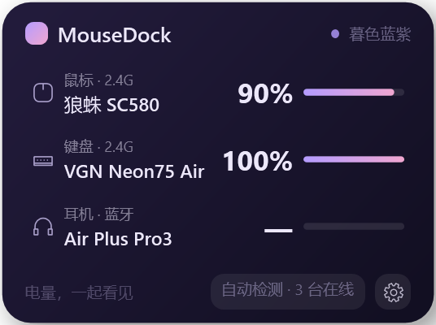
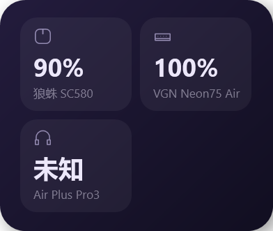
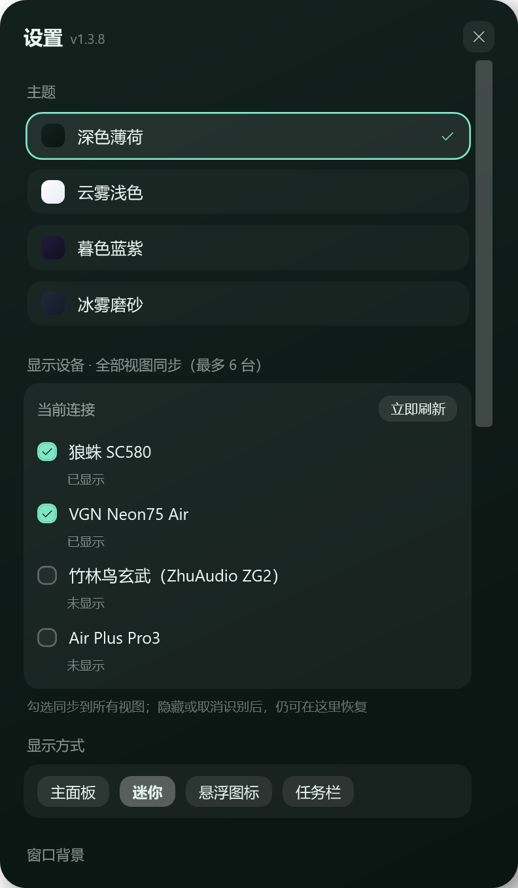

# MouseDock

> Windows 桌面外设电量面板 —— 2.4G / 蓝牙 / 有线自动识别，电量实时刷新。
> 仅检查更新时联网，不上传、无遥测；读不到电量就显示 `—`，绝不编数字。

<p align="center">
  
  
</p>

<p align="center">
  
</p>

<p align="center">
  
  
</p>

## 特性

- **任务栏电量环**：默认固定在主屏任务栏左侧，每台已勾选的设备显示对应图标和独立电量环，背景透明；最多显示 5 台
- **任务栏位置设置**：设置 → 显示方式 → 任务栏，可调整左侧偏移；双击设备图标打开设置，右键打开菜单
- **屏幕右侧电量环**：设置 → 显示方式 → 屏幕右侧，支持自定义图标颜色、上下位置和边距，与其他显示模式互斥
- **数字和充电标记**：任务栏在图标旁、右侧模式在图标下方显示不带 `%` 的电量数字，可关闭；确认充电时显示闪电
- **电量环状态**：绿色为正常、红色为低电量、蓝色为充电、虚线为未知；悬停查看名称和具体百分比
- **只显示当前连接的设备**：内置键盘 / 触摸板 / 摄像头自动过滤；拔出即从列表消失
- **按物理设备去重**：接收器与它背后的鼠标合并成一台，不会出现「接收器 + 鼠标」两条
- **通道判定**：`2.4G` / `蓝牙` / `蓝牙 LE` / `有线`，依据设备路径与产品串，不靠猜
- **电量多策略**：HID 标准电池 → Logitech HID++ → 厂商 32 字节私有协议 → BLE GATT
- **实时刷新**：默认 5 秒轮询（可调 5–120 秒）；USB 插拔由 `WM_DEVICECHANGE` 立即触发
- **三种形态**：卡片面板 / 迷你 2×2 / 悬浮图标；可停靠到 Winstep Nexus
- **普通窗口层级**：不置顶、不抢焦点，其它窗口可以正常盖住它；268×159 起，占桌面很小一块

## 快速开始

本地修改版可运行 `.\build.ps1` 编译，产物为 `dist\MouseDock.exe` 与 `dist\Assets\`。运行时已包含在 exe 中，分发时请保留整个 `dist` 文件夹。脚本优先使用仓库内 `.dotnet\` 下的 SDK。

任务栏模式使用独立透明窗口覆盖任务栏区域，不会为它挤出系统按钮空间。可通过“左侧偏移”避开开始、搜索或天气按钮。它跟随主屏任务栏位置与大小，在任务栏隐藏或全屏应用显示时隐藏。

下完仓库双击 `MouseDock.cmd` 就行。它会自己在仓库里装 .NET 10 SDK（装到 `.dotnet\`，不写注册表）、把程序打成**单个** `dist\MouseDock.exe`（约 77 MB，运行时和图片资源全在里面，不用另装 .NET）、在桌面和开始菜单放 `MouseDock.lnk`，然后把程序拉起来。产物那一个 exe 拷到 U 盘或发给别人也能直接双击跑。

第一次启动要解包到 `%TEMP%\.net\MouseDock\`，慢一些（约 30 秒）；之后启动 5 秒内。

```powershell
git clone https://github.com/late-autumn-gif/MouseDock.git
cd MouseDock
./MouseDock.cmd                    # 一键：装 SDK → 编译 → 建快捷方式 → 启动
.\tools\bootstrap.ps1 -NoLaunch    # 只建快捷方式，不启动
.\tools\bootstrap.ps1 -Rebuild     # 强制重编
./build.ps1                        # 只编译，产物 dist\MouseDock.exe
./install.ps1                      # 只有 dist 已存在时才好用；加 -AutoStart 开机启动
```

`.cmd` 里走的是 `-ExecutionPolicy Bypass`，不改系统脚本策略。压缩包从网上下载的，右键属性里可能有「解除锁定」，不解除会弹安全警告。

构建需要 .NET 10 SDK（`MouseDock.cmd` 发现缺失会自装）；运行需要 Windows 10 1809+ / Windows 11。

## 电量是怎么读到的

| 顺序 | 策略 | 适用设备 |
|---|---|---|
| 1 | HID Usage Page `0x06` / Usage `0x20`（Battery Strength） | 标准实现的外设 |
| 2 | Logitech HID++（`0x1000` / `0x1001`） | 罗技无线 |
| 3 | 厂商 32 字节私有协议（`30 00 01` Identify → 解析电量字节） | AULA / 狼蛛等国产 2.4G 接收器 |
| 4 | BLE GATT `0x180F` / `0x2A19` | 蓝牙 LE 外设 |
| 5 | 以上全部不成立 | 显示 `—`，提示里写明具体原因 |

### 已验证的键盘适配

- MCHOSE K87 V3：2.4G 电量与充电状态。
- RK R98Pro V2：2.4G 电量、接收器连接状态及型号校验；切换到蓝牙后，在下一次检测时撤下离线的 2.4G 通道。刷新间隔可在设置中调整，也可点击“立即刷新”。
- 蓝牙电量取设备公开的标准接口。R98Pro V2 与 G603 的当前测试均返回 100，即使采用非缓存读取也相同；尚未找到更精确的替代读数，不把这一结果当作独立验证的实际满电。
- R98Pro V2 的充电状态尚未验证。

### 回归检查

使用 .NET 10 SDK 运行：

```powershell
dotnet run --project tests/MouseDock.Checks/MouseDock.Checks.csproj -c Release
```

部分检查需要 Windows 桌面和任务栏。更新内容与已知限制见 [CHANGELOG.md](CHANGELOG.md)。

厂商协议的帧格式来自对官方驱动的 USB 抓包还原，文档见 [docs/PROTOCOL.md](docs/PROTOCOL.md)。

## 支持设备

见 [docs/SUPPORTED-DEVICES.md](docs/SUPPORTED-DEVICES.md)。
新增一款设备通常只需在 `Services/Detection/Detection.cs` 的 `VendorMap.KnownReceivers` 加一行 `VID:PID`。

## 关于杀软误报

本程序**只在检查更新时联网、无混淆、无壳、无注入**，全部源码可审计。
自动更新可在设置里关闭，关掉后完全不发起任何网络请求。
但与 HID 设备交互本身容易触发启发式误判，因此：

- **安全模式**：`设置 → 数据源 → 安全模式`，关闭所有厂商通道写操作，只保留标准 HID 读取
- **可复现构建**：见 [docs/BUILD.md](docs/BUILD.md)，附 SHA-256 校验
- **代码签名**：见 [docs/SIGNING.md](docs/SIGNING.md)

## 目录结构

```
src/MouseDock/            应用本体
  Services/Detection/     设备发现、通道判定、电量读取
  Views/                  面板 / 迷你 / 图标 / 设置 / 壁纸墙
tools/                    开发期工具（USB 抓包解析等，不随发行版）
docs/                     协议、构建、签名、支持设备
.github/workflows/        CI：构建与发布
```

## 许可

MIT，见 [LICENSE](LICENSE)。
