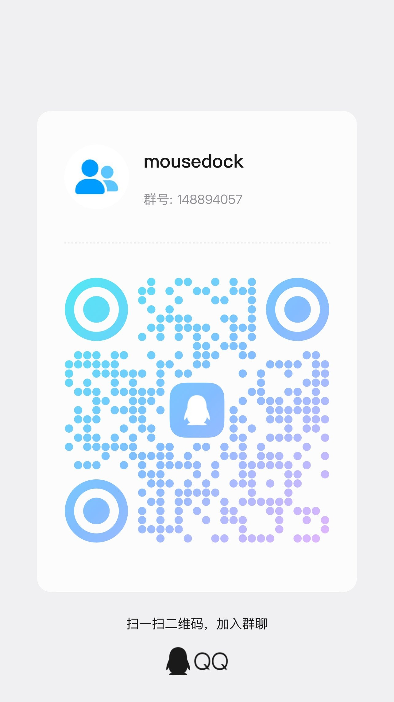

# 关于 MouseDock

一个 Windows 桌面小工具。把鼠标、键盘、耳机的电量摊在桌面上，不用切窗口，不用点托盘。

MIT 开源，代码在 [github.com/late-autumn-gif/mousedock](https://github.com/late-autumn-gif/mousedock)。

---

## 它做什么

```
常驻桌面         面板 / 迷你条 / 悬浮图标，三选一
自动识别         插上就认，2.4G 接收器、蓝牙、有线都走
电量显示         读不到就显示「—」，绝不编数字
低电量提醒       阈值 10 / 20 / 30 / 40，默认 20
自动更新         有新版弹框问你要不要，你说了算
```

## 它不做什么

```
不上传数据       除检查更新外不联网
不做遥测         没有统计、没有埋点、没有账号
不弹广告         没有任何形式的推广
不写注册表       配置都在 %APPDATA%\MouseDock\
```

自动更新会连 `api.github.com` 查一次版本号，请求里只有版本字符串，不带设备信息、不带标识、不带任何能认出你的东西。不想要的话，设置里可以关。

---

## 反馈：产品不适配、功能建议

加 QQ 群，群号 **148894057**。



插上设备显示「—」的时候，最有用的是这两样：

```
1. 设备在设备管理器里的硬件 ID（VID_xxxx&PID_xxxx）
2. MouseDock.exe --hid-probe 的输出
```

有这两样，我大概率能补上。只有型号名不行——同一个型号的不同批次可能换芯片。

---

## 支持开发

这工具是免费的，以后也不会收费。

但开发者是个穷学生，手上设备很有限——很多协议是靠拆厂商网页驱动逆向出来的，一台真机都没有。想验证一个协议对不对，最直接的办法就是有那台设备。

如果你想让它支持更多设备，可以扫这个码：


钱会用来买二手设备做验证。买了哪台、拆出什么协议，都会写进 [release-about.md](release-about.md)。

不捐也完全没关系。加群反馈、报个 bug、说一句「这个型号支持了」，一样有用。

---

## 协议来源

所有电量协议都来自公开渠道：

```
厂商网页驱动      WebHID 明文 JS，直接读
厂商桌面驱动      反编译 / 反汇编
官方支持清单      型号与 VID:PID 对照
社区逆向资料      libratbag / OpenRazer / Solaar
```

没有使用任何需要登录、破解或绕过商业加固的手段。
